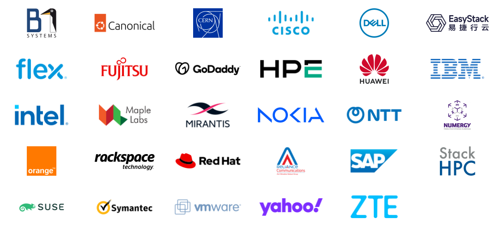
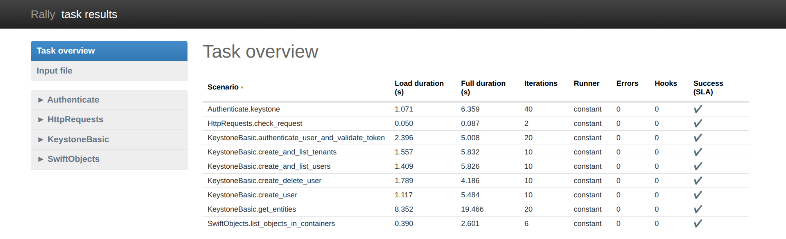
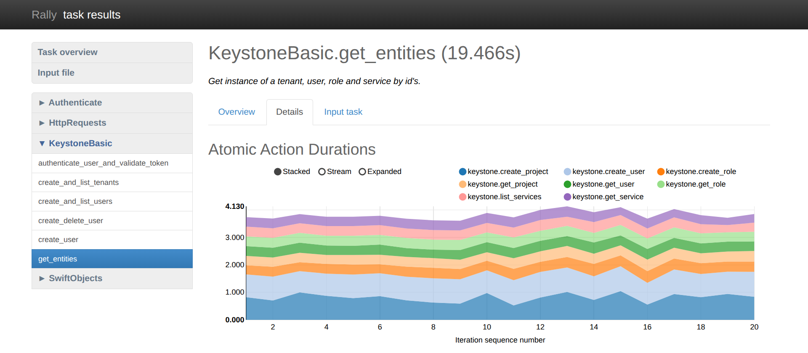
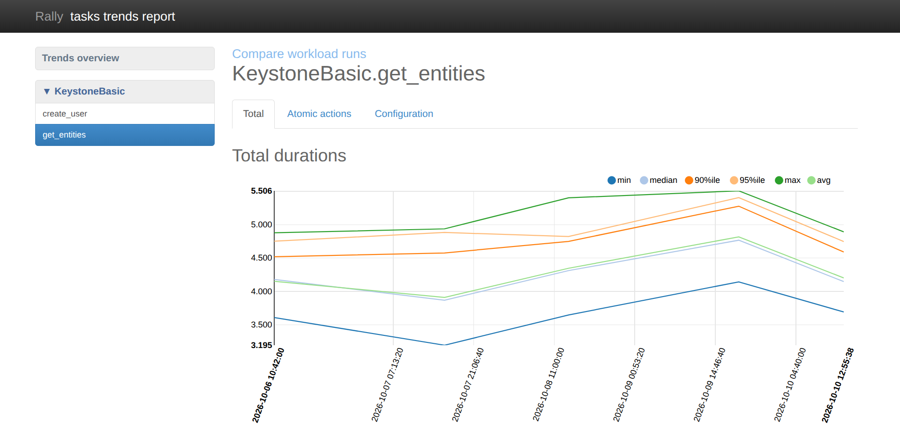

..
      Copyright 2015 Mirantis Inc. All Rights Reserved.

      Licensed under the Apache License, Version 2.0 (the "License"); you may
      not use this file except in compliance with the License. You may obtain
      a copy of the License at

          http://www.apache.org/licenses/LICENSE-2.0

      Unless required by applicable law or agreed to in writing, software
      distributed under the License is distributed on an "AS IS" BASIS, WITHOUT
      WARRANTIES OR CONDITIONS OF ANY KIND, either express or implied. See the
      License for the specific language governing permissions and limitations
      under the License.

.. _overview:

========
Overview
========

.. only:: not rtd

   .. important::

      This site has only the latest documentation, built from the master
      branch. The documentation for each Rally release is on
      `Read the Docs <https://rally.readthedocs.io/>`_.

Rally is a tool for testing how a system behaves under load. You describe
what to do, how hard to push and what counts as success in a task file.
Rally runs it, measures every iteration, keeps the results and turns them
into reports.

The Rally core has no code for any particular system; plugins connect it to
one. OpenStack support comes from the
`rally-openstack <https://pypi.org/project/rally-openstack/>`_ package, a few
generic plugins (for example, HTTP requests) ship with Rally itself, and you
can write plugins for your own services.

.. note::

   This documentation covers two projects: **Rally**, the platform-agnostic
   core, and **rally-openstack**, the plugin package for testing OpenStack
   clouds.

Where to start
==============

* **Evaluating Rally?** Read on: the rest of this page shows what Rally does
  and how its parts fit together.
* **Running your first task?** :ref:`Install <install>` Rally, then follow
  the :ref:`tutorial <tutorial>`.
* **Testing an OpenStack cloud?** The :ref:`tutorial <tutorial>` uses
  rally-openstack throughout; ``rally env create --from-sysenv`` takes the
  credentials from your ``OS_*`` variables. :ref:`verification-component`
  covers Tempest.
* **Writing plugins?** Start with :ref:`plugins`.
* **Contributing to Rally?** See :ref:`contribute`.

Is Rally for you?
=================

**You want to know where your service breaks.**
   Rally runs the same scenario many times, with as many at once as you ask
   for, and times every step inside each run. You see at which load
   response times grow or errors start, and which call is to blame.
   Start with the :ref:`tutorial <tutorial>`.

**You need to check a cloud after a deploy or an upgrade.**
   Reuse your load tasks with a lighter load, without editing them.
   Verification runs a functional test suite such as Tempest and shows what
   broke since the last run. See :ref:`task-component` and :ref:`verification-component`.

**You want CI to catch performance regressions.**
   Run the same task on every change. SLA criteria, such as "no failures"
   or "no iteration slower than two seconds", turn the numbers into a pass
   or a fail, and the trends report shows how the numbers move from run to
   run. rally-openstack itself is tested this way.

**You are choosing between setups.**
   Run one task against two configurations, versions or hardware choices,
   and put the results side by side in one report. See
   :ref:`task-component`.

**You want to watch production the way users see it.**
   Run small tasks in a loop and export every result, for example to
   Elasticsearch. See
   :ref:`plugin-reference` for the exporters.

Who uses Rally
==============

*Want your organization added, changed or removed? Send a patch.*

What Rally is made of
=====================

Rally has three parts, each a command group of the ``rally`` CLI and a
section of these docs. There is no daemon: each command reads and writes the
Rally database (SQLite by default) and exits. Every result stays there, so
old runs remain comparable with new ones.

.. list-table::
   :header-rows: 1
   :widths: 1 1 1
   :class: rally-parts

   * - :ref:`Environment <env-component>`

       ``rally env``
     - :ref:`Task <task-component>`

       ``rally task``
     - :ref:`Verification <verification-component>`

       ``rally verify``
   * - The system you test: where it is and how to reach it, for example
       the URL and credentials of an OpenStack cloud. You create it once,
       and tasks and verifications run against it.
     - Load tests: runs the scenarios of a task file, measures every
       iteration, checks the SLA criteria and builds reports.
     - Functional tests: installs an existing test suite such as Tempest and
       runs it against the environment.

What it looks like
==================

A task is one test run, described in a YAML or JSON file. This one sends 20
HTTP requests, 5 at a time, and passes only if all of them succeed:

.. tab-set::
   :sync-group: format

   .. tab-item:: YAML
      :sync: yaml

      .. literalinclude:: ../../samples/tasks/scenarios/requests/check-request.yaml
         :language: yaml

   .. tab-item:: JSON
      :sync: json

      .. literalinclude:: ../../samples/tasks/scenarios/requests/check-request.json
         :language: json

* ``scenario`` is what to run, with its arguments: here, one HTTP request.
* ``runner`` is how to run it: how many times and how many at once.
* ``contexts`` (not needed here) create what the test needs before it
  starts, such as users or networks in an OpenStack cloud, and delete it
  afterwards.
* ``sla`` says what counts as a failure: here, any failed request.

You can make a test more complex with **hooks**: a hook runs an action, such
as restarting a service, at a given moment of the load. See
:ref:`task-component`.

Run it and build a report:

.. code-block:: console

   $ rally db create
   $ rally env create --name local
   $ rally task start check-request.yaml
   $ rally task report --out report.html

``rally task start`` validates the task and runs it. A task that fails its
SLA is still marked as finished, but the command exits with code 2, so a CI
job fails; the report shows what went wrong. The statuses a task can have
are listed in :ref:`task-statuses`.

The report is a single HTML page. Its overview lists every workload with
its duration, iteration count, errors and SLA result:

         KeystoneBasic.create_user or Authenticate.keystone, with load
         duration, full duration, iterations, runner, errors, hooks and a
         check mark for a passed SLA.

Each workload has its own page with tables and charts. This one shows how
long each step of every iteration took, so a step that gets slower stands
out:

         iterations: a stacked chart of create_project, create_user,
         create_role, get_project, get_user, get_role, list_services and
         get_service, about four seconds per iteration in total.

The trends report puts many runs of the same task together. Here one day's
runs were slower, and the report's atomic actions tab shows that
``keystone.create_user`` was the step to blame:

         runs: the median duration moves around four seconds, rises to
         almost five on 2026-10-09 and drops back the next day, and the
         other lines follow it.

Besides these reports, ``rally task export`` writes the results as JSON or
JUnit XML, or sends them to Elasticsearch.

Plugins
=======

Every part of Rally is built from plugins:

* environments from **platforms**, which know how to reach one kind of
  system;
* tasks from **scenarios**, **runners**, **contexts**, **SLA criteria**,
  **hooks** and their **triggers**, and **exporters**;
* verification from **verifiers** and **reporters**.

Rally loads plugins from every installed package that declares a
``rally_plugins`` entry point, so its own plugins, rally-openstack's and
yours work together: an OpenStack scenario with your own SLA criterion, or
your own scenario with a built-in runner. See :ref:`plugins` and the
:ref:`plugin-reference`.

What Rally is not
=================

* **Not a metrics agent.** Rally measures what its scenarios do, from the
  client side. It does not collect metrics such as CPU or memory usage from
  inside the system under test; your metrics stack does that. For OpenStack,
  Rally can record `OSProfiler <https://docs.openstack.org/osprofiler/>`_
  traces of the calls inside the services, see
  :ref:`tutorial_step_10_profiling_openstack_internals`.
* **Not a replacement for your test suites.** Verification runs existing
  suites and keeps their results; it does not replace them.

.. toctree::
   :hidden:
   :titlesonly:
   :maxdepth: 2

   Overview <self>
   install
   quick_start/index
   cli_reference
   configuration
   env/index
   task/index
   verification/index
   plugins/index
   feature_requests
   project_info/index
   contribute
   user_stories
