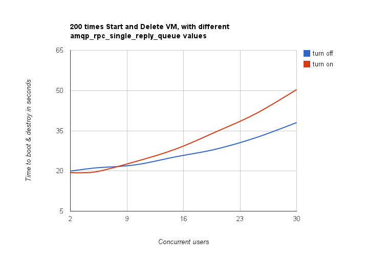

========================================================
How does amqp_rpc_single_reply_queue affect performance?
========================================================

Rally allowed us to reveal a quite an interesting fact about **Nova**. We used
*NovaServers.boot_and_delete_server* scenario to see how the
*amqp_rpc_single_reply_queue* option affects VM bootup time (it turns on a kind
of fast RPC). Some time ago it was
`shown <https://docs.google.com/file/d/0B-droFdkDaVhVzhsN3RKRlFLODQ/edit?pli=1>`_
that cloud performance can be boosted by setting it on, so we naturally decided
to check this result with Rally. To make this test, we issued requests for
booting and deleting VMs for a number of concurrent users ranging from 1 to 30
with and without the investigated option. For each group of users, a total
number of 200 requests was issued. Averaged time per request is shown below:

         concurrent users. With the option on, the time grows from about 19
         to about 50 seconds; with it off, from about 20 to about 38 seconds.
         The lines cross at about 8 concurrent users.

**So Rally has unexpectedly indicated that setting the
*amqp_rpc_single_reply_queue* option apparently affects the cloud performance,
but in quite an opposite way rather than it was thought before.**

Task
----

The task for one point of the chart, in the current task format. Run it for
each concurrency, once with the option on and once with it off:

.. code-block:: yaml

    ---
    version: 2
    title: amqp_rpc_single_reply_queue
    subtasks:
      - title: Boot and delete a server
        scenario:
          NovaServers.boot_and_delete_server:
            flavor:
              name: "{{ flavor_name }}"
            image:
              name: "{{ image_name }}"
        runner:
          constant:
            times: 200
            concurrency: {{ concurrency }}
        contexts:
          users:
            tenants: 1
            users_per_tenant: 1

The flavor, the image and the concurrency are task arguments; pass them when
you start the task:

.. code-block:: console

   $ rally task start amqp.yaml --task-args '{"flavor_name": "m1.tiny", "image_name": "cirros", "concurrency": 10}'
