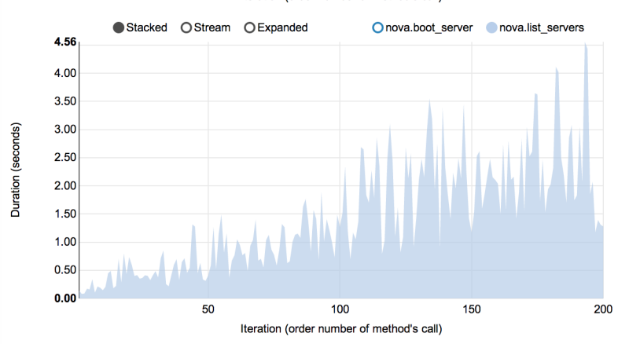

================================
Performance of Nova list command
================================

Another interesting result comes from the *NovaServers.boot_and_list_server*
scenario, which enabled us to launch the following task with Rally:

    * **Task context**: 1 temporary OpenStack user.
    * **Task scenario**: boot a single VM from this user & list all VMs.
    * **Task runner**: repeat this procedure 200 times in a continuous way.

During the execution of this task, the user has more and more VMs on each
iteration. Rally has shown that in this case, the performance of the
**VM list** command in Nova is degrading much faster than one might expect:

         under 0.5 seconds in the first iterations to 2.5 to 4.5 seconds
         after the 100th.

Task
----

The same task in the current task format:

.. code-block:: yaml

    ---
    version: 2
    title: Performance of Nova list command
    subtasks:
      - title: Boot a server and list all servers
        scenario:
          NovaServers.boot_and_list_server:
            flavor:
              name: "{{ flavor_name }}"
            image:
              name: "{{ image_name }}"
        runner:
          serial:
            times: 200
        contexts:
          users:
            tenants: 1
            users_per_tenant: 1

The flavor and the image are task arguments; pass them when you start the
task:

.. code-block:: console

   $ rally task start list-servers.yaml --task-args '{"flavor_name": "m1.tiny", "image_name": "cirros"}'
